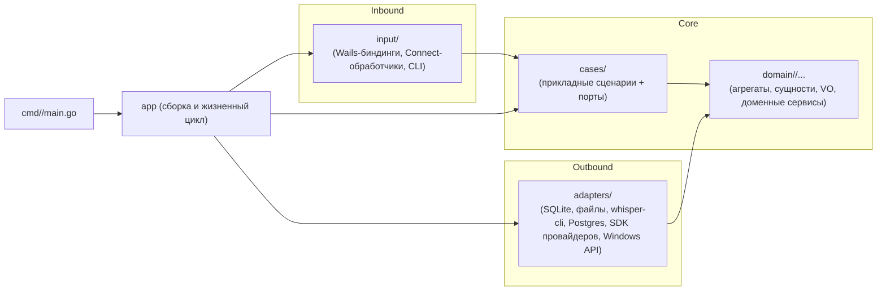

# Архитектура кода

Обязательна для всех сервисов проекта (`desktop`, `hub`). Источник эталона — проект `ai_zalupa_perfomance`
(слои `entities → cases → adapters → input`, сборка в `app`), доработанный под DDD: слой `entities` заменен слоем `domain`
с внутренней структурой по ограниченным контекстам и агрегатам.

Правила пронумерованы (`ARCH-NN`). Ревьюер обязан ссылаться на номер нарушенного правила.
Изменить правило можно только через ADR (`docs/adr/`) с обновлением этого файла и проверок (раздел 10).

Пути в этом документе относятся к модулю сервиса. Например, `internal/domain/...` в сервисе `desktop` означает
`paratech/desktop/internal/domain/...`.

## 1. Слои и направление зависимостей



Адаптеры реализуют порты, объявленные в `cases`, но не импортируют `cases`: порты в Go удовлетворяются структурно.
Все типы, которые пересекают границу порта, живут в `domain` (или являются примитивами), а не в пакете use case.

## 2. Структура каталогов сервиса

```
<service>/
├── cmd/<binary>/main.go          # тонкая точка входа: конфиг, логгер, signal ctx, app.New, Run
├── config/                       # загрузка и валидация конфигурации (env, .env)
├── pkg/                          # артефакты, привязанные к технологии, не слой и не бизнес-код; сейчас pkg/migrations (см. ARCH-04)
├── internal/
│   ├── domain/                   # доменный слой, см. раздел 3
│   ├── cases/<usecase>/          # прикладной слой, см. раздел 4
│   ├── adapters/<tech>/          # реализации портов, см. раздел 5
│   ├── input/<transport>/        # входящие интерфейсы, см. раздел 6
│   ├── app/                      # composition root и жизненный цикл, см. раздел 7
│   └── metrics/                  # метрики и наблюдаемость (прометеевские счетчики и т.п.)
├── testenv/                      # фейки внешнего мира и сборка тестового окружения
└── tests/                        # сценарные тесты поверх настоящих use cases (+ arch_test.go)
```

- **ARCH-01.** Код сервиса лежит только в перечисленных каталогах (`cmd`, `config`, `internal`, `pkg`, `testenv`, `tests`). Новые каталоги верхнего уровня модуля и внутри `internal/` создаются только через ADR.
- **ARCH-02.** Каталог `shared/` (контракты protobuf и сгенерированный код) не содержит бизнес-логики и не импортирует `desktop` или `hub`.
- **ARCH-03.** Имена пакетов короткие, в нижнем регистре, без подчеркиваний и без повторения пути (`job.Status`, а не `job.JobStatus`).
- **ARCH-04.** `pkg/` содержит только нейтральные к бизнесу артефакты, привязанные к технологии и общие для адаптеров и `app`, но не являющиеся кодом слоя: встроенные (`go:embed`) SQL-миграции и в будущем подобные ресурсы. Каждый пакет в `pkg/` имеет `doc.go`. `pkg` импортирует только стандартную библиотеку (и свое дерево во внешних тестах), не содержит бизнес-логики и не знает про слои сервиса. Его импортируют только `adapters` и `app` (а также тесты); `domain`, `cases`, `input`, `cmd`, `config`, `metrics` не импортируют `pkg`. Миграции любой базы данных всегда лежат в `pkg/migrations` (для SQLite desktop — `desktop/pkg/migrations`, для Postgres hub — `hub/pkg/migrations`); адаптер БД только исполняет их. См. ADR-0006.

## 3. Домен (`internal/domain`)

### 3.1 Раскладка

```
internal/domain/
├── shared/                          # общее ядро (shared kernel): типизированные идентификаторы, базовые ошибки. Минимальное.
└── <context>/                       # ограниченный контекст (bounded context)
    ├── doc.go                       # назначение контекста и глоссарий единого языка
    ├── <aggregate>/                 # ПАКЕТ = ОДИН АГРЕГАТ
    │   ├── <aggregate>.go           # корень агрегата: тип, фабрика New…, Restore… для репозиториев, поведение и инварианты
    │   ├── <entity>.go              # внутренние сущности агрегата (не корень)
    │   ├── <value>.go               # объекты-значения агрегата
    │   ├── events.go                # доменные события агрегата
    │   ├── errors.go                # доменные ошибки (sentinel)
    │   └── *_test.go
    ├── values/                      # объекты-значения, общие для нескольких агрегатов контекста
    └── services/<service>/          # доменные сервисы и политики контекста (по пакету на сервис)
```

Примеры для `desktop`: `domain/jobs/job` (агрегат задачи со статусной машиной), `domain/jobs/services/backoff`, `domain/jobs/services/powerpolicy`,
`domain/recording/recording`, `domain/transcription/sttmodel`, `domain/transcription/transcript`, `domain/schedule/lesson`,
`domain/schedule/services/importplan`, `domain/coursework/assignment`, `domain/delivery/delivery`.
Примеры для `hub`: `domain/quota/account`, `domain/access/apikey`, `domain/llm/services/modelallowlist`.

### 3.2 Что куда класть

| Понятие | Где | Признаки |
|---|---|---|
| **Агрегат** (корень) | `<context>/<aggregate>/<aggregate>.go` | Единица согласованности и транзакции. Все изменения внутренних частей идут через методы корня. Корень хранит инварианты |
| **Сущность** внутри агрегата | `<context>/<aggregate>/<entity>.go` | Имеет идентичность, живет только внутри агрегата, снаружи недоступна для прямого изменения |
| **Объект-значение** | в пакете агрегата, либо `<context>/values/` если нужен нескольким агрегатам | Неизменяем, сравнивается по значению, валидируется в конструкторе |
| **Доменное событие** | `events.go` в пакете агрегата | Факт в прошедшем времени (`StatusChanged`, `RecordingFinalized`) |
| **Доменный сервис** | `<context>/services/<service>/` | Бизнес-правило без собственного состояния, затрагивающее несколько агрегатов или не принадлежащее ни одному. Политики (backoff, power policy) тоже здесь |
| **Идентификаторы между контекстами** | `domain/shared` | Типизированные ID (`type RecordingID string`), чтобы контексты не импортировали друг друга |
| **Репозиторий** | порт в `cases/<usecase>/ports.go`, реализация в `adapters/` | В домене интерфейсов репозиториев нет |

### 3.3 Правила домена

- **ARCH-10.** Пакеты `domain/**` импортируют только стандартную библиотеку, другие пакеты своего контекста и `domain/shared`. Никаких `cases`, `adapters`, `input`, `metrics`, `config`, никаких сторонних библиотек (исключения только через ADR).
- **ARCH-11.** Контексты не импортируют друг друга. Связь между контекстами идет по типизированным ID из `domain/shared` и через use cases.
- **ARCH-12.** Один пакет = один агрегат. Внутренние сущности и объекты-значения не выносятся в отдельные пакеты, а доменные сервисы не кладутся в пакет агрегата.
- **ARCH-13.** Агрегат ссылается на другие агрегаты только по ID, не по указателю или значению.
- **ARCH-14.** Состояние агрегата меняется только его методами. Поля неэкспортируемые; конструкция только через `New…` (создает и проверяет инварианты) и `Restore…` (восстанавливает из хранилища без побочных эффектов). Недопустимые переходы возвращают доменную ошибку.
- **ARCH-15.** Домен чист: нет ввода-вывода, горутин, обращения к времени (`time.Now`) и случайности. Время и ID передаются параметрами.
- **ARCH-16.** Доменные события возвращаются или накапливаются агрегатом, публикует их use case. Агрегат ничего не публикует сам.
- **ARCH-17.** Один сервис домена = один пакет с конструктором без зависимостей от инфраструктуры. Если сервису нужен внешний мир, это не доменный сервис, а use case.
- **ARCH-18.** Ошибки домена — sentinel-значения или типы в пакете агрегата/сервиса; адаптеры и use cases проверяют их через `errors.Is/As`.
- **ARCH-19.** Статусные машины (задачи, записи, доставки) реализуются в агрегате и описывают допустимые переходы таблицей; обход через присваивание полей невозможен.

## 4. Прикладной слой (`internal/cases/<usecase>`)

```
internal/cases/<usecase>/
├── service.go        # Service: публичные методы-сценарии
├── ports.go          # интерфейсы, нужные этому use case: репозитории, Clock, внешние клиенты, Tx
├── types.go          # команды/запросы/результаты (DTO уровня use case)
├── errors.go         # ошибки сценария
└── *_test.go         # тесты на фейках портов
```

- **ARCH-20.** `cases` импортируют только `domain/**`, стандартную библиотеку, `internal/metrics` и свой собственный пакет. Другие `cases/*`, `adapters`, `input` — запрещены.
- **ARCH-21.** Порты объявляются в потребляющем пакете (`ports.go`), узкие и по потребности сценария. Названия отражают роль (`JobRepository`, `Clock`, `Messenger`), а не технологию (не `SQLiteJobs`).
- **ARCH-22.** Use case не содержит бизнес-инвариантов: он загружает агрегат через порт, вызывает метод агрегата, сохраняет и публикует события. Если в сценарии появляется условная бизнес-логика, ее место в домене.
- **ARCH-23.** Граница транзакции — один вызов метода use case. Порт `Tx`/`UnitOfWork` объявляется в `ports.go`. Внутри транзакции изменяется один агрегат; согласованность между агрегатами — через события и повторяемые идемпотентные шаги. Два явных исключения, см. ADR-0004(a): пакетная фиксация импорта расписания одним типом агрегата (`ApplyChanges`) и удаление записи вместе с ее транскриптами в одной транзакции.
- **ARCH-24.** Время только через порт `Clock`; случайность и генерация ID — через порты. Прямой `time.Now()` в `cases` и `domain` запрещен.
- **ARCH-25.** Все внешние вызовы принимают `context.Context` первым параметром; сценарии учитывают отмену и таймауты.
- **ARCH-26.** Типы, пересекающие порт, — типы домена или примитивы. DTO use case не передаются в адаптеры.
- **ARCH-27.** Побочные эффекты наружу (email, календарь, файлы) выполняются только через порты и только после проверки, подтверждения и политики. Вывод LLM — недоверенные данные (см. `CLAUDE.md`, правило 3).

## 5. Адаптеры (`internal/adapters/<tech>`)

Один пакет на технологию или внешнюю систему: `sqlite`, `filestore`, `whispercli`, `hubclient`, `winpower`, `wincred`, `smtp`, `googlecal`, `clock`, `postgres`, `anthropic`.

- **ARCH-30.** Адаптеры импортируют `domain/**`, стандартную библиотеку, `internal/metrics`, `pkg` и сторонние библиотеки. `cases`, `input` и другие адаптеры импортировать нельзя.
- **ARCH-31.** Адаптер реализует порты и не содержит бизнес-логики. Преобразование «внешний формат ↔ тип домена» делается внутри адаптера, а не передается наружу.
- **ARCH-32.** Ошибки внешних систем переводятся в доменные или в типизированные ошибки адаптера, пригодные для `errors.Is`; сырые ошибки драйверов наружу не просачиваются.
- **ARCH-33.** Платформенный код (`//go:build windows`) живет только в адаптерах и в `input` Wails. У каждого такого адаптера есть реализация-заглушка для остальных ОС (`_other.go`) или фейк в `testenv`, чтобы проект собирался и тестировался на macOS и Linux.
- **ARCH-34.** Секреты хранятся только через адаптер хранилища секретов (`wincred` и т.п.), не в SQLite и не в логах.
- **ARCH-35.** Генерируемый код (`sqlc`, protobuf) лежит внутри пакета адаптера или в `shared/gen`, не в домене и не в `cases`.
- **ARCH-36.** Контракты protobuf (`shared/gen`) импортируются только адаптерами (клиент Hub) и `input` (обработчики Hub). Типы из `shared/gen` не пересекают границу в `cases` и `domain`.

## 6. Входной слой (`internal/input/<transport>`)

`input/wails` (биндинги десктопа к UI), `input/connect` (Connect-RPC обработчики Hub), `input/cli` (команды выпуска ключей Hub).

- **ARCH-40.** `input` импортирует `cases/*`, `domain/**`, стандартную библиотеку, `internal/metrics`. Адаптеры импортировать нельзя.
- **ARCH-41.** Входной слой тонкий: парсинг и валидация формата запроса, аутентификация транспортного уровня, вызов use case, преобразование результата и ошибок в ответ. Бизнес-решений здесь нет.
- **ARCH-42.** `input` объявляет собственные узкие интерфейсы на используемые use cases (как `CheckInService` в эталоне), чтобы его можно было тестировать на фейках.
- **ARCH-43.** Кодирование данных, специфичных для транспорта (например идентификаторы кнопок), лежит внутри `input`, а не в адаптерах.
- **ARCH-44.** UI (React) не содержит бизнес-правил и секретов; весь доступ к данным идет через биндинги `input/wails`.

## 7. Сборка (`internal/app`, `cmd`, `config`)

- **ARCH-50.** Только `internal/app` знает про все слои и связывает их: адаптеры → use cases → input. Порядок сборки и закрытие ресурсов — в `app.New`, `Run`, `Close`.
- **ARCH-51.** `cmd/<binary>/main.go` содержит только линейную последовательность шагов: загрузка конфигурации (`config.MustLoad`, включая разбор флагов), создание логгера и контекста с сигналами, вызов `app`. Логики нет, `os.Exit` только на уровне `main` и `config.MustLoad` (ADR-0003).
- **ARCH-52.** `config` зависит только от стандартной библиотеки, разбирает флаги и окружение (приоритет: флаги, окружение, значения по умолчанию), валидирует конфигурацию до старта; окружение и флаги не читаются из других мест.
- **ARCH-53.** Глобальные изменяемые переменные, `init()` с побочными эффектами и синглтоны запрещены (исключение: регистрация метрик в `internal/metrics`).

## 8. Тесты

- **ARCH-60.** Юнит-тесты лежат рядом с кодом. Домен тестируется без моков (чистые функции и агрегаты), use cases — на фейках портов.
- **ARCH-61.** Фейки внешнего мира (часы, мессенджер, провайдер, whisper-cli, Google API, SMTP) живут в `testenv/`. Сценарные тесты в `tests/` собирают настоящие use cases и настоящий SQLite и подменяют только внешний мир.
- **ARCH-62.** Каждый статусный автомат и каждый инвариант агрегата покрыт тестом на допустимые и недопустимые переходы.
- **ARCH-63.** Тесты используют управляемые часы и временные каталоги, не реальное время и не реальные пути пользователя.
- **ARCH-64.** Архитектурный тест `tests/arch_test.go` проверяет правила импорта из раздела 9 и обязателен для прохождения в CI.

## 9. Матрица разрешенных импортов (внутри сервиса)

Читать: строка может импортировать столбец.

| из \ в | std | domain/shared | domain свой контекст | domain другой контекст | cases (свой) | cases другой | adapters | input | metrics | app | pkg | shared/gen | сторонние |
|---|---|---|---|---|---|---|---|---|---|---|---|---|---|
| **domain** | да | да | да | нет | нет | нет | нет | нет | нет | нет | нет | нет | нет (ADR) |
| **cases** | да | да | да | да | да | нет | нет | нет | да | нет | нет | нет | нет (кроме `log/slog`) |
| **adapters** | да | да | да | да | нет | нет | нет | нет | да | нет | да | да | да |
| **input** | да | да | да | да | да | да | нет | нет | да | нет | нет | да | да |
| **app** | да | да | да | да | да | да | да | да | да | да | да | да | да |
| **config** | да | нет | нет | нет | нет | нет | нет | нет | нет | нет | нет | нет | нет |
| **pkg** | да | нет | нет | нет | нет | нет | нет | нет | нет | нет | да (свой) | нет | нет |

`cmd` и `metrics` не импортируют `pkg` (ARCH-04, ARCH-51); тесты (`tests/`, `testenv/`) матрицей не ограничены.

Для `cases`/`input`: «domain другой контекст» разрешен, так как use case координирует контексты; запрещено только доменному слою знать про соседний контекст.

## 10. Как правила проверяются

1. **Агент-исполнитель** перед задачей читает этот файл и раскладывает код по слоям. При сомнении — останавливается и спрашивает (архитектор пишет ADR).
2. **Статический контроль** (`depguard` в `.golangci.yml` каждого модуля и `tests/arch_test.go`): запрещенные импорты по матрице раздела 9 (включая правила `pkg`, ARCH-04), отсутствие `time.Now`/`rand` в `domain` и `cases`, отсутствие `import "C"` в `desktop`, раскладка каталогов раздела 2 (в том числе неизвестные каталоги верхнего уровня с Go-кодом и `doc.go` в пакетах `pkg/`).
3. **Ревьюер** (`.claude/agents/reviewer.md`) проверяет каждый diff по чек-листу ниже и ссылается на номера `ARCH-NN`.

Чек-лист ревьюера:
- В diff нет новых зависимостей, нарушающих матрицу импортов (ARCH-04, 10, 11, 20, 30, 40, 50).
- Миграции любой БД лежат в `pkg/migrations`, а не в адаптере (ARCH-04).
- Бизнес-инварианты и переходы состояний находятся в агрегатах, а не в use cases, адаптерах или UI (ARCH-14, 19, 22, 41, 44).
- Доменные понятия лежат по правилам раздела 3.2 (ARCH-12, 13, 17).
- Порты объявлены у потребителя и узкие; через порт проходят только типы домена и примитивы (ARCH-21, 26, 36).
- Нет прямых `time.Now`, генерации ID и случайности в домене и use cases (ARCH-15, 24).
- Платформенный код за build tags, есть заглушка для других ОС (ARCH-33).
- Транзакции и идемпотентность: один агрегат на транзакцию, повторяемые шаги (ARCH-23).
- Тесты соответствуют разделу 8 (ARCH-60…64).

## 11. Отличия от эталона (чего не копировать)

В `ai_zalupa_perfomance` есть три места, которые нарушают чистоту слоев; в новых сервисах их не повторяем:

1. `adapters/chart` импортирует `cases/stats` ради типа `Report` → тип, пересекающий порт, должен жить в `domain` (ARCH-26, 30).
2. `input/telegram` импортирует `adapters/telegram` ради кодирования callback-данных → такое кодирование принадлежит `input` (ARCH-40, 43).
3. Use cases вызывают глобальные счетчики `internal/metrics`. Разрешено как исключение (ARCH-20), но метрики не должны влиять на логику, и в `domain` их быть не может (ARCH-10).

Также вместо встроенной в `db.go` миграции схемы мы используем `goose` + `sqlc` (решение ADR-0001).

## 12. Начальная карта контекстов

Уточняется архитектором через ADR по мере реализации.

**desktop**

| Контекст | Агрегаты | Доменные сервисы |
|---|---|---|
| `recording` | `recording` (состояния, чанки, лимит) | `limits` |
| `jobs` | `job` (статусы PRD §7.2, попытки, ключ идемпотентности) | `backoff`, `powerpolicy` |
| `transcription` | `sttmodel` (версии, pin), `transcript` | `modelselection` |
| `schedule` | `lesson` | `importplan` (превью и конфликты) |
| `coursework` | `assignment`, `homeworkdraft` (версии) | `contextselection` (минимальный контекст для LLM) |
| `delivery` | `delivery` (включая UNKNOWN и сверку) | |
| `settings` | `settings` | |

Use cases (пример): `cases/recordingsession`, `cases/jobrunner`, `cases/transcribe`, `cases/modelcatalog`, `cases/schedulesync`, `cases/homeworkflow`, `cases/senddelivery`.

**hub**

| Контекст | Агрегаты | Доменные сервисы |
|---|---|---|
| `access` | `apikey` | |
| `quota` | `account` (баланс, резервы, журнал), `reservation` | |
| `llm` | | `modelallowlist`, `requestlimits` |

Use cases (пример): `cases/gateway`, `cases/quota`, `cases/keys`. Адаптеры: `postgres`, `anthropic`. Входной слой: `input/connect`, `input/cli`.
