# Learning Assistant — Product Requirements Document

**PRD v0.4 • Local-first Windows MVP**

> [!info] Status
> Draft baseline for implementation planning. This version incorporates the latest architecture and product decisions from the architecture review, plus the technology-stack decisions (§4.3–4.4).

> [!summary] Changes in v0.4
> - **Scope:** the product targets **online classes only**; in-person (offline) classes are out of MVP. Desktop only.
> - **Language/stack:** Go is the primary language for both the desktop app and the LLM Hub. Desktop shell: Wails v3. Client↔Hub contract: Connect-RPC (protobuf). See §4.3–4.4.
> - **STT:** local only; **cloud STT is explicitly prohibited**. whisper.cpp runs as a sidecar process. Models are chosen by the user and either downloaded in-app or imported manually (§8).
> - **Power-aware processing:** heavy local processing runs only on AC power by default; the user can disable this restriction in settings (§7.4).
> - **Calendars:** **Google Calendar only**. Apple Calendar API integration is dropped; events reach Apple Calendar through the user's Google account (§11.3).
> - Recording captures **system audio only (WASAPI loopback)** in one track; microphone recording is deferred (§6.3).
> - **MVP simplifications:** no user login to our own service (Hub access via manually issued per-tester keys, §12); no hardware-specific optimization (CPU-only STT, one sidecar protocol, §4.3); no auto-update (testers install new builds manually); React for the frontend.

> [!important] Core product principle
> The Windows application is **local-first**. User data, recordings, transcripts, assignments, schedules, jobs and artifacts remain on the user's machine by default. Cloud interaction is limited primarily to LLM processing and the infrastructure required to authenticate, enforce quotas and account for usage.

---

## 1. Product vision

Learning Assistant is a Windows desktop application for an individual student. It reduces the manual work around university classes: starting and processing lecture recordings, producing transcripts and summaries, extracting homework and deadlines, generating homework drafts, and keeping the user's academic schedule and tasks synchronized with external calendars.

The first release is intentionally a personal/local product for the author and a small group of testers. It is not a multi-user SaaS and is not optimized for horizontal cloud scale.

The MVP covers **online classes only** (Zoom, Yandex Telemost and similar), recorded on the student's own computer. In-person classes are not considered at this stage. The product is desktop-only.

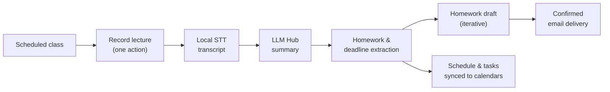

## 2. Goals and non-goals

### 2.1 MVP goals

- Provide a convenient Windows desktop experience for recording a scheduled class with one action.
- Show the recording prompt as a separate non-modal popup/notification window, similar in spirit to Notion's lightweight prompts, without forcing the main application window to the foreground.
- Allow the user to disable/suppress automatic recording prompts and configure the related notification behavior.
- Store application data and large artifacts locally.
- Process speech-to-text locally using a user-selected installed STT model.
- Allow multiple STT models to be downloaded, installed, switched between, updated and removed.
- Persist long-running jobs locally so they can recover after application restart or crash.
- Generate summaries, full transcripts and homework-related artifacts through the LLM Hub.
- Allow iterative homework generation: generate → edit → give additional instructions → regenerate.
- Require explicit user confirmation before sending homework by email.
- Import schedules from ICS and tabular files (CSV/XLSX) and synchronize with Google Calendar through an adapter; help the user see those events in Apple Calendar via their Google account (no Apple API access).
- Run on ordinary student laptops (no powerful hardware assumed): heavy processing is background-only and, by default, only on AC power; the user can turn that restriction off. The MVP does not include hardware-specific optimization; the priority is that it works and works reliably.
- Let the user choose which STT models to install: the app downloads a model itself or sends the user to the source and imports the file afterwards.
- Enforce server-side LLM quotas and expose remaining resource information to the user.

### 2.2 Explicitly out of MVP

- Automatic joining of Zoom or Yandex Telemost classes.
- In-person (offline) classes; the MVP is online-only.
- Cloud speech-to-text of any kind (including as a fallback for weak machines).
- Apple Calendar API integration (EventKit/CalDAV adapter).
- Mobile and non-Windows clients.
- Automatic attendance/voice check-in.
- EOS/LMS integrations.
- Telegram functionality beyond an architectural placeholder.
- Web application.
- Multi-user collaboration or shared academic spaces.
- PostgreSQL, Redis, vector database or other server infrastructure for local application state.
- Admin panel.
- Full bidirectional calendar conflict-resolution engine.
- Automatic homework submission without user confirmation.

## 3. Target user and deployment model

**Primary user:** one student using one Windows PC. The application is installed locally. The same architectural model is used for a small closed group of testers.

**Deployment model:**

- Windows desktop application contains UI, application orchestration, local persistence, job processing, recording, local STT, prompt/context preparation and external integration adapters.
- SQLite is the local system of record for structured state.
- Local filesystem is the artifact store for recordings, transcripts, generated documents and exports.
- The cloud LLM Hub provides authenticated access to LLM providers plus quota/usage control.

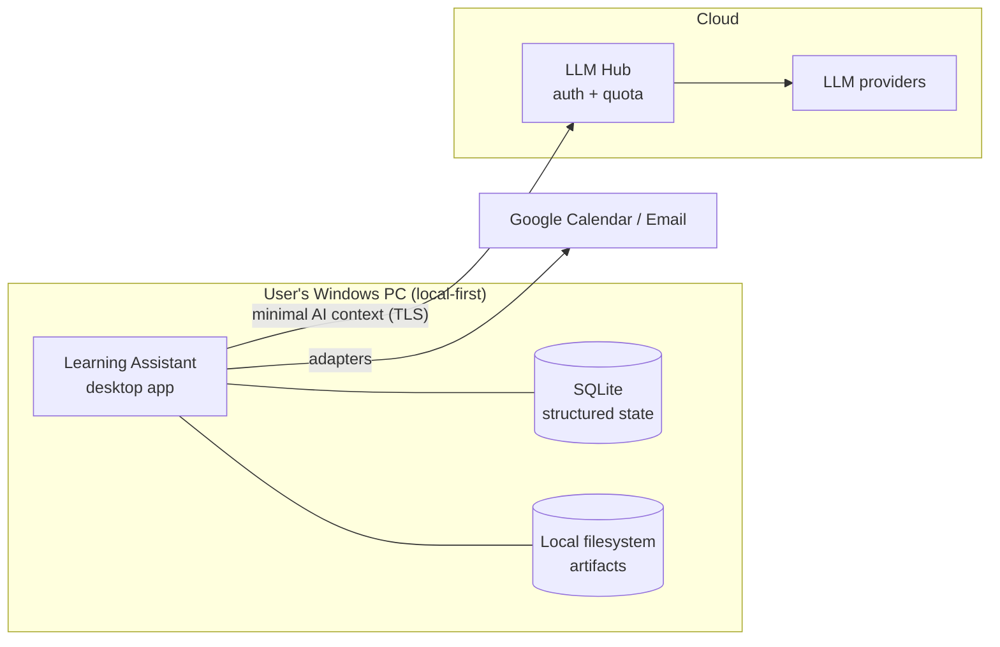

## 4. High-level architecture

The application follows a local-first architecture. The Core is an application orchestration layer rather than a generic business-service gateway. Components execute work locally and use adapters for external APIs.

**Logical architecture:**

- Windows UI → Core → local workflows and managers.
- Core → Storage Manager → SQLite + local File Storage.
- Core → Scheduler / Sync Engine → Calendar adapters.
- Core → Recording Manager → local audio files.
- Core → Persistent Job Store → Worker Pool → STT / AI / integration jobs.
- Core → Prompt & Context Manager → LLM Client → Cloud LLM Gateway.
- LLM Gateway → Quota/Billing → LLM provider adapters.

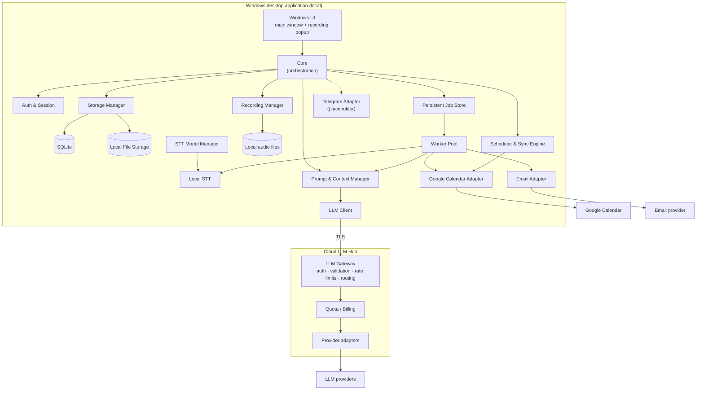

### 4.1 Local components

| Component | Responsibility |
|---|---|
| **UI** | Main application window plus lightweight popup recording prompt. |
| **Core** | Orchestrates user-facing workflows and state transitions. |
| **Auth & Session** | Hub access key handling and integration (Google) authorization state. User login/session lifecycle is postponed beyond MVP. |
| **Scheduler & Sync Engine** | Monitors local schedule and performs controlled calendar synchronization. |
| **Recording Manager** | Starts/stops recording, writes durable audio artifacts and exposes recording lifecycle state. |
| **Persistent Job Store + Worker Pool** | SQLite-backed durable jobs plus in-process workers. |
| **STT Model Manager** | Downloads, verifies, installs, updates, selects and removes local speech-recognition models. |
| **Local STT** | Executes speech recognition without sending raw audio to the cloud. |
| **Prompt & Context Manager** | Selects local context and constructs LLM requests. |
| **Storage Manager** | Abstracts SQLite and filesystem persistence, retention, atomic writes and artifact access. |
| **Google Calendar Adapter / Email Adapter** | Isolate external API details from Core. |
| **Telegram Adapter** | Future placeholder only. |

### 4.2 Cloud LLM Hub

| Component | Responsibility |
|---|---|
| **LLM Gateway** | Authenticated request boundary, request validation, rate limits and provider routing. |
| **Quota / Billing** | Server-side quota reservation, settlement, usage accounting and limits. |
| **Provider adapters** | Connect the gateway to selected LLM providers. |

Prompt and context management remains local. The cloud should receive only the information required for a particular AI operation, rather than becoming the system of record for the user's academic data.

### 4.3 Technology stack

Go is the primary language of the project, for the desktop application and for the LLM Hub. The code base lives in a Go workspace (`go.work`) with `desktop/`, `hub/` and `shared/` (protobuf definitions and generated code) modules in the `paratech/` repository.

| Layer | Choice | Notes |
|---|---|---|
| **Desktop shell** | **Wails v3** (Go + WebView2), TypeScript frontend with **React** (Vite) | Multi-window, system tray and NSIS installer packaging are supported. Wails v3 is currently in beta (v2 is the stable line): accepted risk. Autostart and single-instance are not assumed to be built in and are covered by small Go libraries. Auto-update is not part of MVP. |
| **Local database** | SQLite via `modernc.org/sqlite` (pure Go, no CGO), `sqlc` for queries, `goose` for migrations | Matches §5.1. |
| **Job queue** | Custom, on top of SQLite; goroutine worker pool | Matches §7. Ready-made queues such as River require Postgres and are not used locally. |
| **Local STT** | **whisper.cpp as a sidecar process**: the Go app starts the CLI (`whisper-cli`) as a separate process for each transcription job | Isolates crashes from the app, keeps the main binary CGO-free, makes cancellation trivial (kill the process), and pins the model by file and arguments. No long-lived server and no ports to manage. **CPU-only in MVP**; GPU backends (Vulkan, OpenVINO) are deferred. |
| **Audio capture** | WASAPI loopback (system audio), chunked WAV/FLAC written to disk | Implementation is to be chosen in a spike: `malgo` (miniaudio, needs CGO), a pure-Go WASAPI binding, or a small dedicated recorder process. Chunked writes support crash recovery (§6.2). |
| **Power state** | Windows `GetSystemPowerStatus` plus power-broadcast notifications | Drives power-aware processing (§7.4). |
| **Secrets** | Windows Credential Manager (`wincred` / `go-keyring`) | Matches §12 and AC-19. |
| **Authorization (Google)** | `golang.org/x/oauth2`; system browser, Authorization Code + PKCE, loopback redirect | Used for Google Calendar access in MVP. User login to our own service is postponed (§12). |
| **Hub access (MVP)** | Per-tester API key issued manually by the author; stored in Windows Credential Manager on the client, hashed on the Hub | Keeps the LLM Hub protected and allows quota and cost per tester without an identity system. |
| **Calendar** | Google Calendar API (`google.golang.org/api/calendar/v3`); ICS via `golang-ical`; XLSX via `excelize`; CSV via stdlib | See §11. |
| **Email** | SMTP (`go-mail`) with credentials in Windows Credential Manager (proposed); Gmail API possible later | Proposed because SMTP works with any provider (Gmail, Yandex, university mail). To be confirmed. |
| **LLM Hub** | Go, `net/http` + `chi`, Connect-RPC, Postgres (`pgx`) for quota ledger and usage, `anthropic-sdk-go` / `openai-go`, deployed in Docker | The "no PostgreSQL" rule in §2.2 applies to local application state only; quota reservation and settlement need server-side transactions. |
| **Packaging** | NSIS installer produced by Wails | No auto-update in MVP; testers install new builds manually. |
| **Tooling** | `log/slog`, `testify`, `golangci-lint`, `buf` | |

### 4.4 Client–Hub API contract

The contract exists only between the Go desktop client and the Go Hub (the UI talks to the Go core through Wails bindings, not to the Hub). **Connect-RPC with protobuf** is the chosen contract technology.

| Criterion | OpenAPI + codegen | **Connect-RPC (chosen)** | gRPC | JSON + shared Go module | GraphQL |
|---|---|---|---|---|---|
| Fit for Go↔Go | good | **Go-first** | good | **ideal** | excessive |
| Code generation | yes | yes (`buf`) | yes | not needed | yes |
| Schema evolution guard | medium | **strong** (`buf breaking`) | strong | implicit (same module) | medium |
| Streaming LLM responses | manual SSE | **native server streaming** | native | manual SSE | subscriptions, complex |
| Works through proxies/student networks | yes | **yes (HTTP/1.1)** | worse (HTTP/2) | yes | yes |
| `curl` debugging | **yes** | **yes (JSON mode)** | no | **yes** | yes |
| Third-party clients/docs | **best** | medium | medium | none | medium |
| Learning curve | low | medium | medium | **lowest** | high |

Rationale: OpenAPI's main advantage is language independence and public documentation, which this single-client product does not need. Connect-RPC gives typed schemas, breaking-change detection (old client builds will coexist with a newer Hub during the pilot), streaming for LLM output, and interceptors for authentication, idempotency keys and retries. Fallback if protobuf proves too heavy: plain JSON over a shared Go module.

### 4.5 Code architecture

The code of both services follows the layered DDD architecture defined in `docs/architecture.md` (layers `domain` → `cases` → `adapters`/`input`, composition in `app`; rules `ARCH-NN`, enforced by lint, an architecture test and code review).

## 5. Local persistence

### 5.1 SQLite

SQLite is the preferred MVP database because the product is single-user and local-first. Running PostgreSQL in Docker or as a local service would add operational complexity without solving a current product problem.

SQLite should contain structured application state such as schedule records, assignments, job state, settings, integration metadata, model metadata and local usage/cache metadata.

### 5.2 Local filesystem

Large or binary artifacts should remain outside SQLite: recordings, exported files, model files, generated documents and other large artifacts.

All filesystem access should go through Storage Manager rather than being scattered through Core.

### 5.3 Data ownership

The local academic dataset is the source of truth for the user's assignments and schedule. Calendars are external representations/integrations, not the canonical store for homework.

| Store | What lives there | Role |
|---|---|---|
| **SQLite** | Schedule records, assignments, job state, settings, integration metadata, model metadata, local usage/cache metadata | System of record for structured state |
| **Local filesystem** | Recordings, exported files, model files, generated documents, other large artifacts | Artifact store (accessed only via Storage Manager) |
| **Windows-protected credential storage** | Refresh tokens / long-lived credentials | Secrets (never plaintext SQLite) |
| **External calendars** | Projections of schedule/tasks | Integration / view, **not** canonical |
| **Cloud LLM Hub** | Quota & usage accounting | Authoritative for quota/billing only |

## 6. Recording experience

### 6.1 Scheduled recording prompt

When Scheduler detects that a lesson is starting, the application presents a small popup/notification window rather than opening or focusing the main application window.

- Primary action: **Start recording**.
- Secondary action: dismiss/snooze/ignore according to the configured notification behavior.
- The popup must not block other applications.
- The user can disable automatic recording prompts globally.
- The user can re-enable prompts from settings.

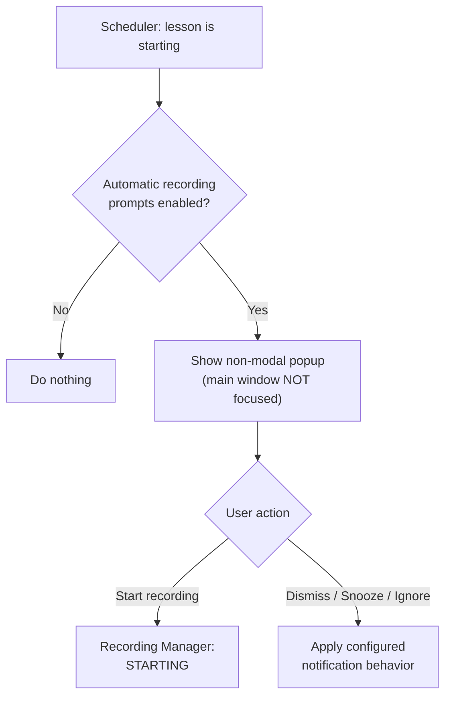

### 6.2 Recording lifecycle

- `STARTING`
- `RECORDING`
- `STOPPING`
- `FINALIZING`
- `COMPLETED`
- `FAILED`
- `RECOVERY_REQUIRED`

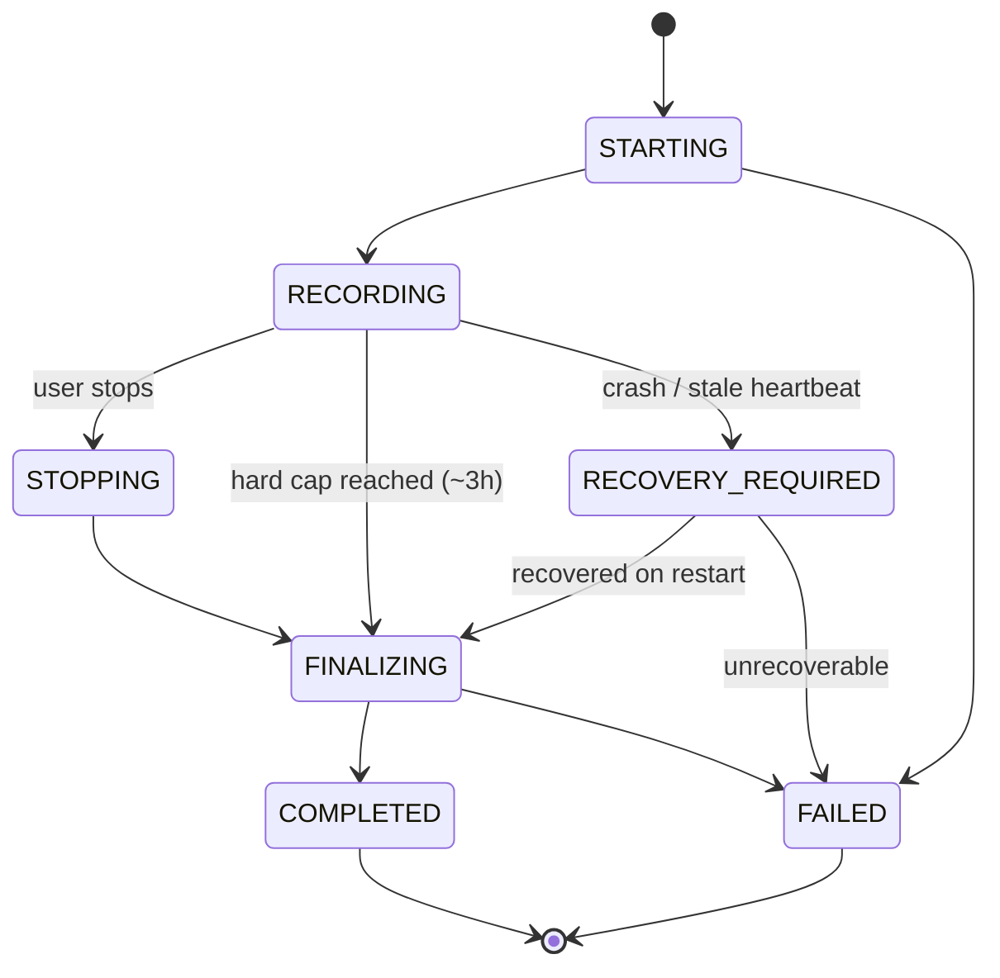

A hard maximum recording duration of approximately **3 hours** is recommended for MVP. At the limit, the system finalizes the recording rather than leaving an indefinitely running process.

A watchdog/heartbeat records the health of the recording session. After application restart, stale/incomplete sessions are detected and recovered or presented to the user for recovery.

### 6.3 Audio sources (online classes)

"Recording" means capturing the audio of an online class on the student's computer. Because the MVP covers online classes only, the audio source is **system audio output (WASAPI loopback)**: everything the computer plays, i.e. the teacher's and classmates' voices from Zoom, Yandex Telemost and similar tools. The result is **one audio track**.

Microphone recording (the student's own voice) is **not part of MVP**; it is a possible later addition as a separate track. Audio is written to disk in chunks so that a crash loses at most the latest chunk.

## 7. Persistent jobs and worker pool

### 7.1 What this means

A persistent job is a durable record in SQLite describing work that must be completed. A worker is an in-process execution loop that claims an eligible job and performs it. The worker itself is ephemeral; the job state is durable.

This means the MVP does **not** require Redis, RabbitMQ or Kafka.

### 7.2 Example lifecycle

- Job created → `QUEUED`.
- Worker claims job → `RUNNING`.
- Successful completion → `COMPLETED`.
- Transient failure → `RETRY_WAIT` / `QUEUED` with backoff.
- User cancellation → `CANCELLED`.
- Permanent error → `FAILED`.
- Network unavailable for an LLM job → `WAITING_FOR_NETWORK`.
- Quota unavailable → `WAITING_FOR_QUOTA`.
- Heavy local job while the computer runs on battery (and power-aware processing is enabled) → `WAITING_FOR_POWER`.

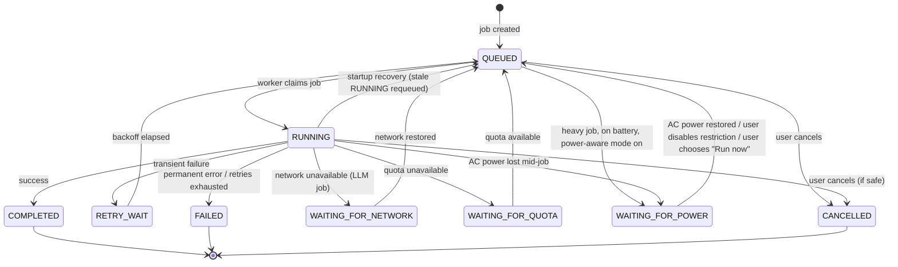

On application startup, the Job Recovery process identifies stale `RUNNING` jobs and either resumes or safely requeues them according to job type.

### 7.3 Reliability requirements

- Idempotency for jobs that can cause external side effects.
- Retry with bounded exponential backoff for transient failures.
- Timeouts for external requests.
- Persistent state transitions rather than in-memory-only progress.
- Cancellation where technically safe.

### 7.4 Power-aware processing

Local speech recognition is CPU-intensive and the target machines are modest student laptops. Therefore:

- Heavy local jobs (primarily STT) run **in the background** and, **by default, only while the computer is on AC power**.
- On battery, such jobs enter `WAITING_FOR_POWER` and resume automatically when AC power returns. The UI shows the reason for waiting.
- **The user can disable this restriction** in settings (global toggle: "Process recordings only when plugged in"), and can override it for a single job with a "Run now" action.
- If AC power is lost while a job is running, the worker stops at the next safe checkpoint (chunk boundary), persists progress and moves the job to `WAITING_FOR_POWER`. Whether the job may also continue until a battery threshold is a point to confirm.
- Lightweight jobs (UI-driven LLM requests, email delivery, calendar sync) are not affected.
- Processing is a background activity and must not noticeably degrade a live online class. Priority and thread limits are to be tuned during Phase 4.

## 8. STT Model Manager

Speech-to-text is local in MVP. **Cloud STT is prohibited** (no raw audio leaves the machine, and no cloud fallback exists for weak machines). Users should not be forced to use one hard-coded model: the user decides which models to install.

- Display available/downloadable STT models.
- Download a model from a trusted model source, **started by the application itself**, with resume support and progress.
- Alternatively, **redirect the user to the model's source page** and let them **import the downloaded file** into the model manager.
- Support importing a user-supplied model not present in the catalog, after explicit user confirmation and a checksum check.
- Verify download integrity/checksum.
- Track installed model name, version, size and capabilities.
- Allow several models to be installed simultaneously.
- Allow the user to select the active default model.
- Allow a specific processing job to pin the exact model/version used.
- Allow model removal when no active job depends on it.
- Warn about required disk space before download.
- Support model update as a separate explicit operation.
- Recommend a model for the current machine based on detected CPU, RAM and GPU, and warn when a chosen model is likely to be slow on this hardware.

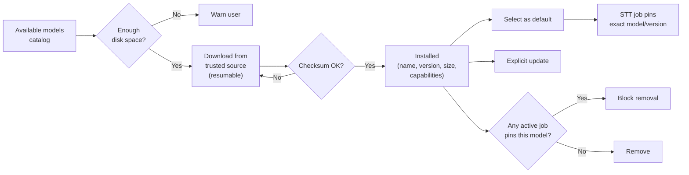

### 8.1 Model catalog and acquisition

The catalog is a manifest listing, for each model: name, version, size, SHA-256, source URL, quantization, capabilities and recommended minimum CPU/RAM. Default recommendations favor small quantized models (e.g. `base`/`small` in `q4_0` or `q5`) on CPU-only machines; larger models such as `large-v3-turbo` are an opt-in choice for stronger hardware. Real-time factors on typical student laptops are to be measured in Phase 4 before defaults are fixed.

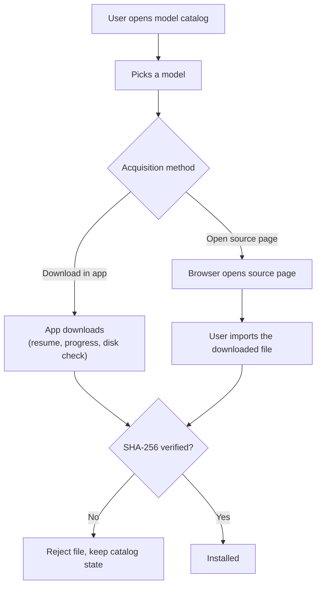

The model manager should isolate model acquisition from the STT execution engine. This keeps the STT pipeline independent from the exact model family chosen later.

## 9. AI / LLM pipeline

### 9.1 Local context construction

The Prompt & Context Manager selects the minimum relevant local context, builds the prompt and sends an LLM request through the LLM Client. Raw local data should not be uploaded merely because it exists.

### 9.2 Quota lifecycle

1. Reserve quota before starting an expensive request.
2. Execute request.
3. Settle against actual usage returned by the provider.
4. Release unused reservation on cancellation/failure where appropriate.
5. Record idempotency keys to prevent double charging.

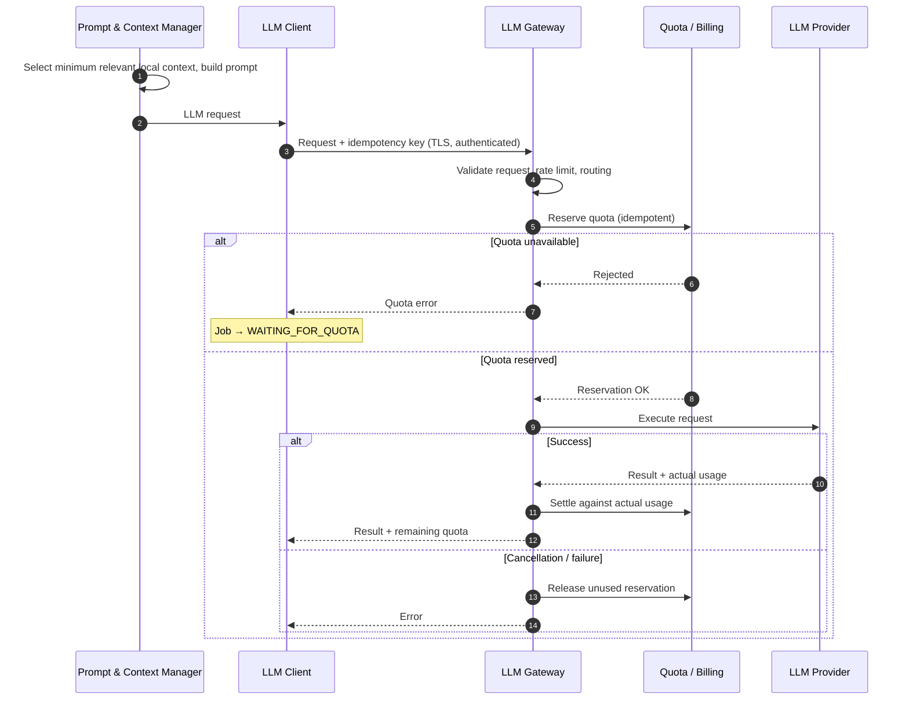

The cloud quota state is authoritative. The Windows UI may show cached usage, but local usage state must not be treated as the final authority for billing or quota enforcement.

## 10. Homework workflow

The user should be able to iterate on AI-generated homework before sending it.

1. Select assignment or lesson context.
2. Generate a draft.
3. Review/edit locally.
4. Provide additional instructions.
5. Regenerate or refine.
6. Export/save the final artifact.
7. Explicitly confirm sending.
8. Create a delivery job.
9. Send through Email Adapter.
10. Persist delivery result and retry/reconcile if necessary.

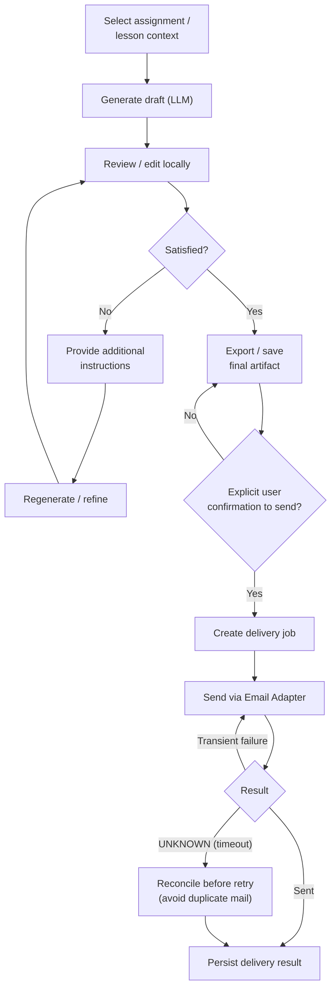

The MVP does not require a complex domain entity called *Submission*. A delivery record/job is sufficient to represent an attempt to send a particular artifact to a particular recipient.

## 11. Calendar and schedule

### 11.1 Source of truth

Local academic data is canonical. Calendar integrations are convenient external views/synchronization targets.

### 11.2 MVP imports

- ICS
- CSV
- XLSX

Imports should use a **preview/validation/commit** flow. Malformed input must not silently overwrite the local schedule.

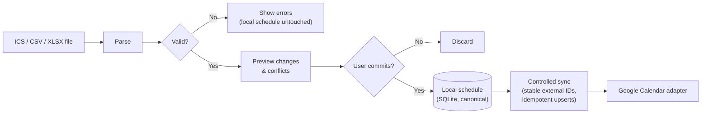

### 11.3 External calendars

**Google Calendar is the only external calendar integration in MVP.** It is isolated behind an adapter. Full bidirectional conflict resolution is deferred; the first implementation prefers controlled synchronization (stable external IDs, idempotent upserts) over an unconstrained distributed synchronization system.

- The app writes events to a **dedicated secondary calendar** (e.g. "Learning Assistant") that it creates itself, using the narrow Google OAuth scope `calendar.app.created`, which limits access to calendars created by the app. Reading the user's primary calendar is not required in MVP, since the schedule comes from ICS/CSV/XLSX.
- Google Calendar authorization is separate from user authentication (§12).
- Apple Calendar has no API integration: there is no usable Apple Calendar API on Windows, and the product does not need one.

**Seeing events in Apple Calendar.** The app shows a "How to view in Apple Calendar" guide. No Apple credentials and no public calendar are required:

| Option | How it works | Access needed | Verdict |
|---|---|---|---|
| **A. Add the Google account on iPhone/Mac** (Settings → Calendar → Accounts) | Apple syncs all calendars of the Google account, including "Learning Assistant" | The user signs in to Google on the Apple device; the app does nothing extra | **Recommended** |
| B. Subscribe to the calendar's "secret address in iCal format" | The user copies the link from Google Calendar settings and subscribes in Apple Calendar | Link copied manually (to be verified: not exposed via API) | Read-only, refresh interval configurable; fallback |
| C. Make the calendar public | Anyone with the link can see events | None | **Not recommended** (privacy) |

**Pilot risk:** an unverified Google OAuth app in "Testing" status may issue refresh tokens that expire after about 7 days and is limited to listed test users. To be verified against Google documentation and decided before the pilot (verification vs. test-user mode).

## 12. Authentication, authorization and secrets

> [!note] MVP scope
> To test the viability of the product, **the MVP has no user authentication in our own service** (no accounts, sign-up or login). Authentication becomes mandatory after the viability test and is deferred, not dropped. In MVP:
> - The LLM Hub is protected by a **per-tester API key issued manually by the author**. It is stored in Windows Credential Manager on the client and only its hash is stored on the Hub. It enables quota enforcement and per-tester cost measurement.
> - **Google Calendar authorization (OAuth) stays**, because the calendar integration needs the user's consent. It is authorization to a third-party API, not login to our service.
> - The flow below applies to Google authorization now and is the baseline for user login later.

Authentication and authorization are distinct concerns. OAuth/OIDC-style login is a candidate mechanism for post-MVP user authentication, but the final provider/protocol choice should be confirmed at that stage.

For a native Windows application, the security baseline is:

- Use the system browser for interactive identity-provider authentication rather than embedding a login page in the application.
- Use Authorization Code + PKCE for native-app authorization flows.
- Do not embed a client secret in the Windows application.
- Store refresh tokens or other long-lived credentials in Windows-protected credential storage rather than plaintext SQLite.
- Keep user authentication separate from authorization to Google Calendar/email.
- Use short-lived access tokens where supported and refresh securely.
- Provide logout/revocation behavior.
- Do not treat a local installation ID as proof of identity or authorization. (In MVP the Hub API key is a shared secret issued to a known tester, not proof of end-user identity.)

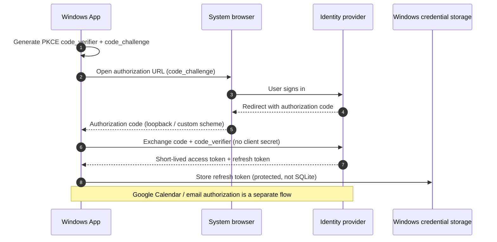

The product is single-user in MVP, so collaborative access control and shared academic spaces are out of scope.

## 13. Security and privacy

### 13.1 Local security

- Private application-data directory.
- Protected storage for credentials.
- Controlled filesystem permissions.
- Optional/considered at implementation: encryption of sensitive local database/artifacts based on threat model.
- Clear deletion semantics for recordings, transcripts, derived artifacts and caches.

### 13.2 LLM Hub security

- TLS for all network traffic.
- Authenticated client requests (in MVP: per-tester API key).
- Rate limiting and payload size limits.
- Strict provider/model allowlists.
- No arbitrary outbound URLs supplied by the client.
- Minimal pseudonymous identifiers.
- No unnecessary academic profile data in every request.
- Provider credentials remain server-side.

### 13.3 Prompt injection

LLM output is untrusted input. The LLM must not directly execute side effects.

For actions such as sending email or changing local state, the flow must be:

> **LLM proposes structured result → Core validates against trusted local state → policy/user confirmation → adapter performs the side effect.**

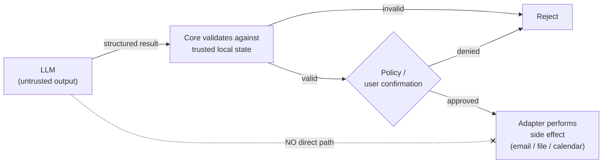

Prompt-injection defenses should include structured outputs, strict tool boundaries, input/content separation, output validation and allowlists. No security control should rely solely on the model refusing a malicious instruction.

## 14. Reliability and failure cases

| # | Failure case | Expected handling |
|---|---|---|
| 1 | Application crash during recording | Detect stale session on startup and recover/finalize where possible. |
| 2 | Recording exceeds 3 hours | Force finalization. |
| 3 | Internet disappears during recording | Recording continues locally. |
| 4 | Internet disappears during cloud AI | Job waits and retries later. |
| 5 | Duplicate *Generate* click | Deduplicate/guard concurrent equivalent jobs. |
| 6 | Quota reservation duplicated | Idempotency keys and server-side accounting. |
| 7 | Email send times out after provider may have accepted it | Mark result `UNKNOWN` and reconcile before retrying to avoid duplicate mail. |
| 8 | Calendar sync repeats | Stable external IDs and idempotent upserts. |
| 9 | Import contains conflicting schedule | Preview and explicit commit. |
| 10 | STT model download interrupted | Resumable/retryable download and integrity verification. |
| 11 | Installed STT model is removed while a job depends on it | Job pins model version and model manager prevents unsafe deletion or marks job unavailable. |
| 12 | Laptop is unplugged while an STT job is running (power-aware mode on) | Stop at the next checkpoint, persist progress, set `WAITING_FOR_POWER`, resume when AC power returns. |
| 13 | Imported/downloaded model file is corrupted or tampered with | Checksum verification fails; the file is rejected and not installed. |

## 15. Notifications

The MVP should provide a minimal notification policy rather than a full notification-rule engine.

- Enable/disable automatic recording prompts.
- Configure whether completed processing should notify the user.
- Respect Windows notification behavior where possible.
- Do not spam the user with repeated notifications for the same job state.

## 16. Core acceptance criteria

| ID | Acceptance criterion | Area |
|---|---|---|
| AC-01 | At scheduled lesson start, a non-modal recording popup can be shown without forcing the main application window to the foreground. | Recording UX |
| AC-02 | The user can globally disable and re-enable automatic recording prompts. | Recording UX |
| AC-03 | A recording can be started/stopped from the popup and is durably stored locally. | Recording |
| AC-04 | A recording is automatically finalized at the configured hard maximum (target: 3 hours). | Recording |
| AC-05 | An interrupted recording can be detected and recovered/reconciled after application restart. | Recording |
| AC-06 | STT runs locally; raw lecture audio is never uploaded to the LLM Hub or any other cloud service, and no cloud STT fallback exists. | STT |
| AC-07 | The user can install multiple STT models and select which installed model is the default. | STT |
| AC-08 | An STT job records the exact model/version used for reproducibility. | STT |
| AC-09 | Long-running jobs survive application restart through SQLite-backed persistent state. | Jobs |
| AC-10 | Transient job failures retry with bounded backoff; jobs do not run forever. | Jobs |
| AC-11 | Cloud LLM usage is quota-controlled server-side and duplicate charging is prevented. | LLM Hub |
| AC-12 | The user can view remaining relevant quota/resources. | LLM Hub |
| AC-13 | The user can generate, edit and iteratively refine homework before sending. | Homework |
| AC-14 | Sending homework requires explicit user confirmation. | Homework |
| AC-15 | Email delivery results are stored locally and ambiguous delivery states are not blindly retried. | Homework |
| AC-16 | ICS/CSV/XLSX schedule import supports validation/preview before committing changes. | Schedule |
| AC-17 | Google Calendar access is isolated through an adapter and limited to an app-created calendar; no Apple Calendar API is used. | Schedule |
| AC-18 | LLM output cannot directly invoke email, filesystem or calendar side effects. | Security |
| AC-19 | Long-lived external credentials are not stored as plaintext in SQLite. | Security |
| AC-20 | Local academic data remains the system of record; external calendars are integrations/views. | Data |
| AC-21 | By default, heavy local processing (STT) runs only on AC power; jobs on battery wait in `WAITING_FOR_POWER` and resume automatically. | Jobs |
| AC-22 | The user can disable the AC-power restriction in settings and can run a single waiting job immediately. | Jobs |
| AC-23 | The user can install an STT model either by in-app download or by importing a manually downloaded file; both paths verify a checksum. | STT |
| AC-24 | The app records system audio (loopback) from online classes into a single track. | Recording |
| AC-25 | Every LLM Hub request is authenticated with a per-tester API key; keys can be revoked on the Hub. | Security |

## 17. Implementation sequence

| Phase | Name | Scope |
|---|---|---|
| 0 | Architecture baseline | Finalize ADRs for local-first architecture, SQLite/filesystem, job persistence, LLM boundary, authentication and side-effect security. Set up the Go workspace and the Connect-RPC/`buf` toolchain. |
| 1 | Windows foundation | UI, Core, Storage Manager, SQLite, filesystem layout, Scheduler and basic settings. Begins with a Wails v3 spike: non-focus-stealing popup, tray, notifications, autostart and single instance. |
| 2 | Recording UX | Non-modal popup, notification suppression, Recording Manager, watchdog, 3-hour cap and crash recovery. |
| 3 | Persistent jobs | SQLite job store, worker pool, lifecycle states, retry, cancellation, startup recovery. |
| 4 | Local STT | whisper.cpp sidecar plus Model Manager: catalog, in-app download or manual import, verify, install, select, switch, pin versions; hardware-based recommendations, benchmarks on typical student laptops and power-aware scheduling. |
| 5 | LLM Hub | Gateway, per-tester API key check, quota reservation/settlement, provider adapter and usage accounting. |
| 6 | AI post-processing | Transcript → summary → homework/deadline extraction and local persistence. |
| 7 | Homework assistant | Generate/edit/instruct/regenerate/export and confirmed email delivery. |
| 8 | Schedule integrations | ICS/CSV/XLSX import, then the Google Calendar adapter and the Apple Calendar viewing guide. |
| 9 | Security/reliability hardening | Credential storage, privacy controls, prompt-injection defenses, idempotency, reconciliation, telemetry and failure testing. |
| 10 | Closed pilot | Deploy to the author and small tester group; measure usefulness, reliability, latency, model quality and per-user AI cost. |

```mermaid
flowchart LR
    P0["Phase 0<br/>Architecture<br/>baseline"] --> P1["Phase 1<br/>Windows<br/>foundation"]
    P1 --> P2["Phase 2<br/>Recording UX"]
    P2 --> P3["Phase 3<br/>Persistent jobs"]
    P3 --> P4["Phase 4<br/>Local STT"]
    P4 --> P5["Phase 5<br/>LLM Hub"]
    P5 --> P6["Phase 6<br/>AI post-processing"]
    P6 --> P7["Phase 7<br/>Homework assistant"]
    P7 --> P8["Phase 8<br/>Schedule<br/>integrations"]
    P8 --> P9["Phase 9<br/>Security / reliability<br/>hardening"]
    P9 --> P10["Phase 10<br/>Closed pilot"]
```

## 18. Deferred roadmap

- Zoom/Yandex Telemost automatic joining or recording integration.
- Automatic attendance/check-in.
- EOS/LMS integrations.
- Telegram notifications/quick input.
- Multi-user SaaS and collaboration.
- Web application.
- Advanced calendar bidirectional sync/conflict resolution.
- Admin panel.
- Server-side academic data store.
- Vector search/RAG infrastructure if real product requirements emerge.

## 19. Open decisions / ADR backlog

| # | Decision | Status |
|---|---|---|
| 1 | Desktop technology/runtime. | **Decided:** Go + Wails v3 (beta, accepted risk); frontend: React + TypeScript |
| 2 | User authentication in our own service. | **Postponed:** not in MVP; per-tester API keys for the Hub. Mandatory after the viability test |
| 3 | STT model families and defaults. | Open, low priority: no hardware-specific tuning in MVP; pick a sensible default and confirm it works |
| 4 | Exact quota unit: tokens, processing time, weighted credits or a hybrid. | Open |
| 5 | Local database encryption decision based on threat model. | Open |
| 6 | Retention/deletion policy for recordings and derived artifacts. | Open |
| 7 | Calendar integration scope. | **Decided:** Google Calendar only, app-created secondary calendar; Apple Calendar via the Google account (§11.3) |
| 8 | Email delivery. | Proposed: SMTP with user-supplied credentials; to be confirmed |
| 9 | Cloud LLM provider set and routing policy. | Open |
| 10 | Client–Hub API contract technology. | **Decided:** Connect-RPC (protobuf) |
| 11 | Cloud STT as a fallback. | **Decided:** prohibited in MVP |
| 12 | Behavior on battery. | **Decided:** heavy processing only on AC power by default, user-disableable; details (battery threshold for running jobs) open |
| 13 | How to capture system audio on Windows from Go (WASAPI loopback): `malgo` (CGO), pure-Go binding, or a small recorder process. | Open: resolved by a spike |
| 14 | Wails v3 spike result: non-focus-stealing popup, tray, notifications, autostart, single instance. | Open |
| 15 | Google OAuth verification vs test-user mode for the pilot (refresh-token lifetime). | Open |
| 16 | STT sidecar protocol and GPU backend. | **Decided for MVP:** `whisper-cli` process per job, CPU-only |

## 20. Product success metrics for pilot

| Metric | Category |
|---|---|
| Percentage of scheduled lessons successfully recorded. | Reliability |
| Percentage of recordings successfully transcribed. | Reliability |
| Median time from recording completion to transcript availability. | Latency |
| Median time from transcript completion to useful summary/homework extraction. | Latency |
| User correction rate for extracted homework/deadlines. | Quality |
| Number of duplicate/failed jobs per 100 jobs. | Reliability |
| Number of duplicate external side effects. | Reliability |
| LLM cost per active tester per week. | Cost |
| User-reported usefulness and frequency of actual use. | Usefulness |
| Median STT processing time relative to recording length on typical student laptops. | Performance |
| Share of STT jobs delayed by the AC-power condition, and share of users who disable it. | Usability |

---

*End of PRD v0.4.*
